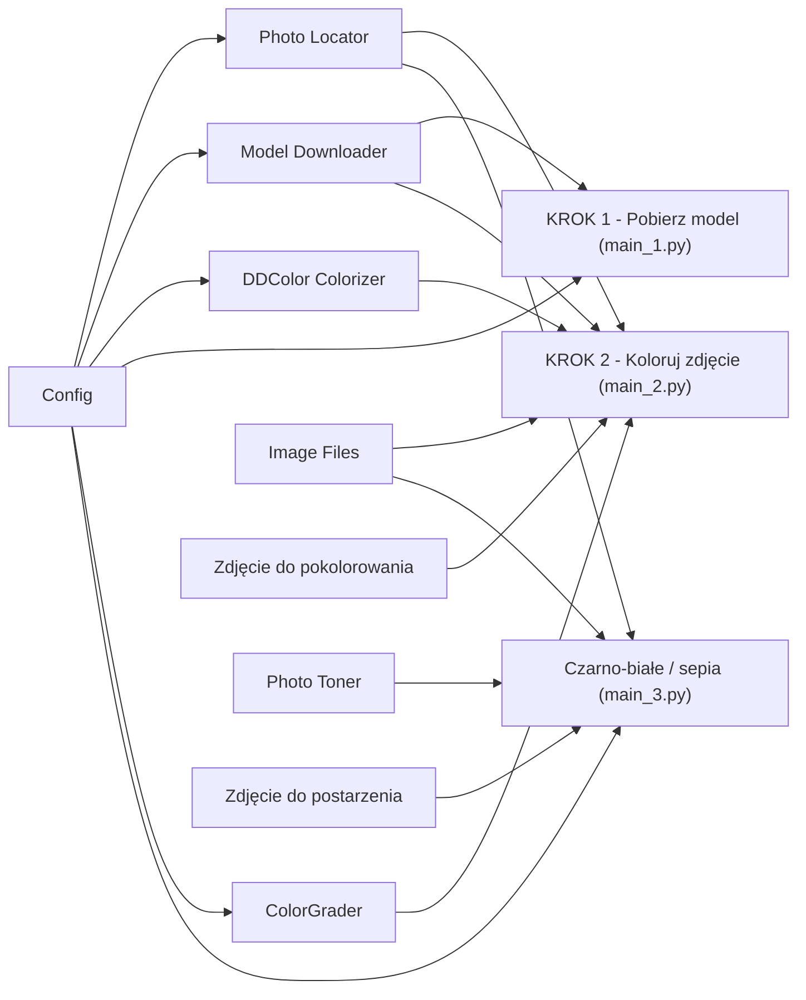

# ColorAI — kolorowanie starych zdjęć lokalnie, modelem DDColor

Koloruje czarno-białe i sepiowe zdjęcia **na Twoim komputerze**, bez wysyłania ich do internetu.
Używa modelu **[DDColor](https://github.com/piddnad/DDColor)** (ICCV 2023), który przewiduje tylko kolor
(kanały a/b przestrzeni Lab), a jasność, szczegóły i rozdzielczość zostawia z oryginału — sieć ogląda
kopię 512×512, a jej kolory są skalowane i nakładane na zdjęcie w pełnym rozmiarze.

Dodatkowo projekt ma proste narzędzie (bez AI), które zamienia kolorowe zdjęcie na czarno-białe albo
sepię — przydatne do przygotowania zdjęć testowych.

Projekt jest zbudowany w CatNip — wizualnym edytorze Pythona opartym na blokach. Każdy blok to jedna
klasa w osobnym pliku `.py` z własną stroną dokumentacji `.md`.

> [!WARNING]
> **To jest projekt poglądowy (edukacyjny).**
> Kolory dobiera model AI — to jego **przypuszczenie**, a nie odtworzenie prawdziwych barw sceny.
> Pokolorowanego zdjęcia nie należy traktować jako dokumentu historycznego ani dowodu, jak coś
> naprawdę wyglądało. Kolorując cudze zdjęcia, upewnij się, że masz do nich prawa. Model i kod sieci
> pochodzą od autorów DDColor i podlegają ich licencji. Autor projektu nie ponosi odpowiedzialności
> za sposób wykorzystania wyników.

## Trzy kroki

| Skrypt | Blok w CatNip | Co robi | Pakiety |
|---|---|---|---|
| `main_1.py` | **KROK 1 - Pobierz model** | Pobiera wagi DDColor (~870 MB) z Hugging Face i kod sieci z GitHuba do `models/`. Wystarczy raz; przerwane pobieranie jest wznawiane. | brak (biblioteka standardowa) |
| `main_2.py` | **KROK 2 - Koloruj zdjęcie (AI)** | Koloruje zdjęcie, opcjonalnie poprawia barwy (korekta tonalna), zapisuje `output/<nazwa>_color.<rozszerzenie>` i pokazuje wynik oraz porównanie „przed / po”. Bez modelu na dysku najpierw go pobiera. | `torch`, `torchvision`, `numpy`, `opencv-python-headless` |
| `main_3.py` | **Opcjonalnie - Czarno-białe / sepia** | Zamienia kolorowe zdjęcie na sepię albo czarno-białe i zapisuje je w `input/` jako `<nazwa>_sepia.jpg` / `<nazwa>_bw.jpg`. | `numpy`, `opencv-python-headless` |

## Wymagania

- **Python 3.10 lub 3.11** (projekt był uruchamiany na 3.11).
- Pakiety z [`requirements.txt`](requirements.txt): `torch`, `torchvision`, `numpy`, `opencv-python-headless`.
- **Ok. 1 GB miejsca na dysku** na model i **dostęp do internetu** przy pierwszym uruchomieniu
  (KROK 1). Potem wszystko działa offline.
- Opcjonalnie karta NVIDIA z CUDA. Program sam sprawdza, czy zainstalowana wersja PyTorch obsługuje
  kartę; jeśli nie (np. starsze karty jak GTX 1050 Ti z nowymi wersjami PyTorch) albo gdy zabraknie
  pamięci GPU, liczy na CPU — wolniej, ale zawsze zadziała.
- **CatNip** — opcjonalnie, do podglądu wyników w zakładce Output.

## Instalacja

```bash
git clone <adres-repozytorium>
cd ColorAI

python -m venv .venv
# Windows:
.venv\Scripts\activate
# Linux / macOS:
source .venv/bin/activate

pip install -r requirements.txt
```

Na komputerze z kartą NVIDIA zainstaluj najpierw `torch` i `torchvision` w wersji z CUDA według
instrukcji na [pytorch.org](https://pytorch.org/get-started/locally/), a dopiero potem `requirements.txt`.

## Uruchomienie

### W CatNip

1. Otwórz `ColorAI.catnip` w CatNip.
2. Uruchom **KROK 1 - Pobierz model** (raz).
3. W bloku **Zdjęcie do pokolorowania** wskaż zdjęcie i uruchom **KROK 2 - Koloruj zdjęcie (AI)**.
   Wynik pojawi się w zakładce **Output** i w folderze `output/`.
4. Opcjonalnie: w bloku **Zdjęcie do postarzenia** wskaż kolorowe zdjęcie i uruchom
   **Opcjonalnie - Czarno-białe / sepia** z argumentem `sepia` albo `grayscale` (domyślnie sepia).

### Bez CatNip

```bash
python main_1.py              # KROK 1: pobierz model (raz)
python main_2.py              # KROK 2: pokoloruj zdjęcie
python main_2.py temperature=15 tint=-15 saturation=1.5 highlight_warmth=70   # z korektą barw
python main_3.py sepia        # opcjonalnie: sepia (albo: grayscale / bw)
```

Poza CatNip podgląd obrazu jest pomijany — wynik znajdziesz w `output/` (albo w `input/` dla sepii).

### Skąd brane jest zdjęcie

Zdjęcie wskazuje się w blokach *File content* na kanwie CatNip. Program czyta tę ścieżkę z pliku
`ColorAI.catnip`; jeśli plik nie istnieje (np. na innym komputerze albo w Dockerze), szuka go **po nazwie**
w folderze projektu, `photos/` i `input/`. Gdy nic nie znajdzie, bierze **najnowszy obraz**:

- KROK 2 — z `input/`, a potem z `photos/`,
- czarno-białe / sepia — z `photos/`.

Najprościej więc wrzucić zdjęcie do `input/` (do kolorowania) albo `photos/` (do postarzenia).
Obsługiwane formaty: `.jpg`, `.jpeg`, `.png`, `.bmp`, `.tif`, `.tiff`, `.webp`; ścieżki z polskimi
znakami działają.

## Struktura projektu



| Blok | Plik | Do czego służy |
|---|---|---|
| Config | `ColorAIConfig.py` | Wszystkie ścieżki i ustawienia (foldery, model, rozmiar wejścia, ton, jakość JPEG, korekta barw), edytowalne w panelu INITIALISER. |
| Image Files | `ImageFiles.py` | Odczyt i zapis obrazów (OpenCV), także ze ścieżek z polskimi znakami; uwzględnia obrót EXIF; podgląd w zakładce Output. |
| Photo Locator | `PhotoLocator.py` | Znajduje zdjęcie wskazane w bloku File content, po nazwie albo najnowsze w folderze. |
| Model Downloader | `ModelDownloader.py` | Pobiera wagi i kod sieci z wznawianiem przerwanego transferu; pomija to, co już jest. |
| DDColor Colorizer | `DDColorColorizer.py` | Wczytuje model raz i koloruje zdjęcie na GPU albo CPU (z powrotem na CPU przy braku pamięci GPU). |
| ColorGrader | `ColorGrader.py` | Korekta tonalna barw po DDColor (balans bieli, nasycenie, vibrance, odcień, tonowanie świateł i cieni, usuwanie dominanty) — tylko kanały a/b Lab, jasność i szczegóły bez zmian. |
| ColorGrading | `ColorGrading.py` | Rekord z ustawieniami korekty barw i ich zakresami; bez złączy. Config buduje go ze swoich parametrów, ColorGrader go stosuje. |
| Photo Toner | `PhotoToner.py` | Czarno-białe (luminancja BT.601) albo sepia z lekko podniesioną czernią. |
| Zdjęcie do pokolorowania | — | Blok File content: zdjęcie dla KROKU 2. |
| Zdjęcie do postarzenia | — | Blok File content: zdjęcie dla narzędzia sepii. |
| KROK 1 / KROK 2 / Opcjonalnie | `main_1.py`, `main_2.py`, `main_3.py` | Trzy punkty wejścia opisane wyżej. |

Każdy blok ma swoją szczegółową dokumentację w pliku `.md` o tej samej nazwie.

### Pliki i foldery

| Ścieżka | Opis | W repozytorium |
|---|---|---|
| `ColorAI.catnip` | Projekt CatNip (graf bloków). | tak |
| `*.py`, `*.md` | Kod i dokumentacja bloków, trzy skrypty `main_N.py`. | tak |
| `requirements.txt` | Zależności Pythona. | tak |
| `photos/` | Przykładowe kolorowe zdjęcia do postarzenia. | tak |
| `models/` | Wagi (~870 MB) i kod sieci DDColor — pobiera je KROK 1. | nie |
| `input/` | Zdjęcia do pokolorowania (oraz wyniki sepii). | nie |
| `output/` | Pokolorowane zdjęcia. | nie |

## Konfiguracja

Wszystkie ustawienia są parametrami `__init__` klasy `ColorAIConfig` (blok **Config**, plik `ColorAIConfig.py`).
W CatNip zmienia się je w panelu **INITIALISER** bloku Config: **Refresh** wczytuje wartości z kodu, a po
zmianie **Apply** zapisuje je z powrotem. Bez CatNip zmienia się wartości domyślne w tej linii `__init__`.
Złe ustawienie zatrzymuje run od razu, z czytelnym komunikatem.

| Parametr | Domyślnie | Zakres | Działanie |
|---|---|---|---|
| `project_dir` | `""` | ścieżka albo pusto | Folder projektu; pusto = folder z `ColorAI.catnip` |
| `models_folder`, `input_folder`, `output_folder`, `photos_folder` | `models`, `input`, `output`, `photos` | nazwy folderów | Foldery względem folderu projektu |
| `weights_repo` | `piddnad/ddcolor_modelscope` | repozytorium HF | Wariant modelu. Inne warianty autorów: `piddnad/ddcolor_artistic` (żywsze kolory), `piddnad/ddcolor_paper` (wersja z publikacji). Po zmianie uruchom ponownie KROK 1 |
| `weights_files` | `("pytorch_model.bin", "config.json")` | krotka nazw | Pliki wag; pierwszy to wagi |
| `code_repo`, `code_commit` | `piddnad/DDColor`, `2adb63f…` | repozytorium + commit | Kod sieci przypięty do jednego commita, żeby późniejsze zmiany autorów nie zmieniły działania |
| `code_packages` | `("ddcolor", "basicsr")` | krotka nazw | Pakiety wypakowywane z archiwum kodu |
| `input_size` | `512` | wielokrotność 32, ≥ 64 | Rozmiar, w jakim sieć ogląda zdjęcie |
| `default_tone` | `sepia` | `sepia`, `grayscale` | Ton narzędzia postarzania bez argumentu |
| `jpeg_quality` | `95` | 1…100 | Jakość zapisu JPEG |
| `temperature` | `0` | −100…100 | Korekta barw: + cieplej (żółć), − chłodniej (błękit) |
| `tint` | `0` | −100…100 | Korekta barw: + magenta, − zieleń (usuwa fioletowy nalot) |
| `saturation` | `1.0` | 0…3 | Korekta barw: mnożnik nasycenia; 0 = czarno-białe |
| `vibrance` | `0` | −100…100 | Korekta barw: wzmacnia głównie blade barwy |
| `hue_shift` | `0` | −180…180 | Korekta barw: obrót odcieni w stopniach |
| `highlight_warmth` | `0` | −100…100 | Korekta barw: ociepla (+) lub chłodzi (−) jasne partie |
| `shadow_warmth` | `0` | −100…100 | Korekta barw: ociepla (+) lub chłodzi (−) ciemne partie |
| `cast_removal` | `0` | 0…1 | Korekta barw: usuwa dominantę barwną („szary świat”) |
| `image_extensions` | `(".jpg", …, ".webp")` | krotka rozszerzeń | Pliki uznawane za zdjęcia |

### Korekta tonalna barw (KROK 2)

DDColor zgaduje kolory i czasem daje zdjęcie zbyt chłodne, sine albo blade. Parametry korekty z tabeli
(`temperature` … `cast_removal`) dostrajają wynik bez ponownego kolorowania przez model. Domyślne wartości
niczego nie zmieniają. Ustawia się je na stałe w INITIALISER bloku Config albo na jeden run jako argumenty
KROKU 2 (w CatNip: Run Engine → argumenty), które nadpisują wartości z Config:

```bash
python main_2.py temperature=15 tint=-15 saturation=1.5 highlight_warmth=70 shadow_warmth=-20
```

Korekta zmienia tylko barwę (kanały a/b Lab), nigdy jasności ani szczegółów. Gdy jest włączona, wynik
prosto z modelu zapisywany jest obok jako `<nazwa>_color_raw`. Wartość spoza zakresu albo nieznana nazwa
zatrzymuje run od razu, przed wczytaniem modelu.

## Podziękowania i licencje

- **DDColor** — Xiaoyang Kang i in., *DDColor: Towards Photo-Realistic Image Colorization via Dual
  Decoders*, ICCV 2023. Kod: [github.com/piddnad/DDColor](https://github.com/piddnad/DDColor),
  wagi: [huggingface.co/piddnad/ddcolor_modelscope](https://huggingface.co/piddnad/ddcolor_modelscope).
  Model i kod nie są częścią tego repozytorium — pobiera je KROK 1 i podlegają licencji autorów.
- Licencja tego projektu nie została jeszcze wybrana — do czasu dodania pliku `LICENSE` wszystkie prawa
  zastrzeżone.

## Zastrzeżenie

Projekt ma charakter wyłącznie **poglądowy i edukacyjny**. Kolory nadane przez model są przybliżeniem,
a nie wiernym odtworzeniem rzeczywistości. Korzystasz z niego na własną odpowiedzialność.
